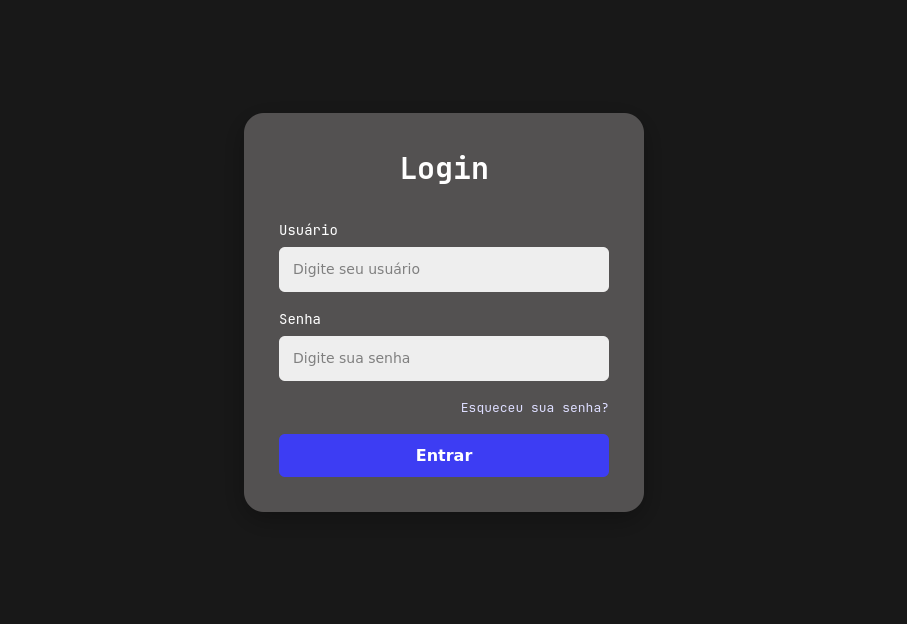

# 🔐 Tela de Login

Uma página de login desenvolvida com **HTML5 e CSS3**, com foco em estruturação semântica, estilização, responsividade e boas práticas de desenvolvimento frontend.

## 🖥️ Preview

## 🖥️ Preview



## 🛠️ Tecnologias utilizadas

- **HTML5**
- **CSS3**

## ✨ Recursos

- Formulário de login com campos de usuário e senha.
- Layout centralizado utilizando Flexbox.
- Design responsivo.
- Efeitos de `hover` e `focus`.
- Transições suaves.
- Suporte a preenchimento automático.

## 📂 Estrutura do projeto

```text
tela-de-login/
├── index.html
├── style.css
├── README.md
├── LICENSE
└── .gitignore
```

## 🚀 Como executar

1. Clone o repositório:

   ```bash
   git clone https://github.com/nycolas-lima/tela-de-login.git
   ```

2. Entre na pasta:

   ```bash
   cd tela-de-login
   ```

3. Abra o arquivo `index.html` no navegador.

## 📄 Licença

Este projeto está sob a licença [MIT](LICENSE).